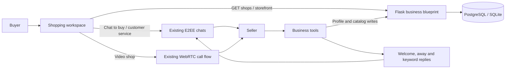

# Ducor Shopping Marketplace Architecture

## Product scope

Shopping is a first-class workspace beside Chats on desktop and a Shop tab in
the mobile chat navigation. It is removed from the message attachment menu.
The marketplace helps customers discover opt-in local shops, browse products
and projects, start a private seller conversation, and move into a video call
to inspect an item. Sellers manage their public storefront, catalog and support
automations through the existing Business tools.

The current purchase handoff is seller-mediated: **Chat to buy** opens the
existing encrypted direct chat with a prefilled product inquiry. A buyer and seller agree on availability,
delivery and payment there, and can use the app's existing payment composer.
The marketplace does not yet claim payment capture, order tracking, refunds,
escrow or seller payouts. Those require a separate order/payment lifecycle and
provider settlement design.

## Architecture overview

The frontend owns marketplace presentation and search state in
`components/ShopMarketplace.jsx`. The home composition owns entry points and
passes the existing chat and call actions. Flask routes authenticate the
viewer, enforce opt-in publication, and serialize only storefront-safe data.
The existing `BusinessProfile`, `CatalogProduct`, `BusinessAutomation`,
`BusinessProfileView`, chat, message and call models remain the source of truth.

## Roles and capabilities

| Capability | Customer | Seller |
| --- | --- | --- |
| Discover shops | Search published shops by name, category and location | Opt in to appear in Shopping |
| View products/projects | Browse available catalog items and prices | Add, update, remove items and set stock |
| Ask questions or buy | Start an encrypted chat with the seller | Handle customer chats and share payment details |
| Inspect by video | Start an in-app video call with the seller | Answer a customer call using existing call controls |
| Storefront | Open a public, app-hosted shop profile | Register website, business profile, address and hours |
| Customer service | Chat with seller | Use welcome, away and keyword auto-replies |

## Data model

### Existing records reused

- `BusinessProfile`: business name, category, description, address, support
  details, website, hours, and catalog visibility.
- `CatalogProduct`: product/project name, description, INR price, image and
  stock availability.
- `BusinessAutomation`: welcome and away messages, keyword rules and
  explicit `ai_enabled` customer-support opt-in.
- `BusinessProfileView`: storefront view analytics.
- `Chat`, `ChatParticipant`, `Message` and `CallRecord`: secure customer
  support, purchase discussion and call lifecycle. `Chat.is_shop_chat` marks a
  buyer/seller conversation so participant phone fields stay hidden there.

### Marketplace publication

`BusinessProfile.marketplace_enabled` is the seller's explicit opt-in. The
field defaults to false, so existing businesses do not become publicly
discoverable after deployment. `catalog_visible` remains a second visibility
switch. A shop appears in public search only when both switches are enabled.
The schema upgrade is additive and the runtime compatibility migration adds
the column to existing databases.

No customer email, personal phone or internal automation data is returned by
the public marketplace serializers. A seller's registered website and shop
address are public while the listing is on. Video calls route through in-app
chat identity rather than revealing phone numbers.

## API contracts

All endpoints require the existing bearer token.

| Method and path | Purpose | Access |
| --- | --- | --- |
| `GET /api/business/shops?q=&category=&location=` | Search published shops; returns compact shop cards with up to six in-stock items | Authenticated users; published records only |
| `GET /api/business/storefront/<business_user_id>` | Load a single published storefront and full catalog; records a profile view | Authenticated users; published records only |
| `POST /api/business/shop-chat` | Open or create a buyer/seller chat without requiring a contact entry | Authenticated buyer; published shop only; blocks enforced |
| `GET /api/business/me` | Load seller profile, catalog and automation | Owner |
| `PUT /api/business/profile` | Save profile, website, catalog visibility and marketplace opt-in | Owner |
| `POST /api/business/products` | Add a catalog listing | Owner |
| `PUT /api/business/products/<id>` | Edit listing or stock | Owner |
| `DELETE /api/business/products/<id>` | Remove listing | Owner |
| `PUT /api/business/automation` | Save customer-service automations | Owner |
| `POST /api/business/automation/claim` | Atomically claim one incoming message and optionally return a generated AI reply | Shop owner in that chat |
| `GET /api/business/analytics` | Read profile views, product and message counts | Owner |

The older contact-only `GET /api/business/<id>` remains for the existing chat
profile drawer. Marketplace discovery uses the separate storefront contract so
existing chat privacy rules do not change.

## Main user flows

### Seller setup and publication

1. Seller opens Shopping and chooses **List your shop**, or opens Settings →
   Business tools → Business profile.
2. Seller registers the business name, category, description, address, support
   details, website and opening hours.
3. Seller adds products/projects in Catalog / Products, with price, image,
   description and stock.
4. Seller turns on **List my shop in Shopping** and saves. This explicitly
   publishes the storefront. Turning it off hides the store from discovery and
   storefront routes without deleting its catalog or private business data.
5. Seller enables welcome, away or keyword replies. Seller may separately
   enable AI customer support. The AI switch is off by default and the UI
   explains that customer messages are sent to the configured AI provider.

### Customer discovery and purchase conversation

1. Customer opens Chats → Shopping and searches by shop name, category or
   location.
2. Customer opens a shop and reviews its website, address, hours and catalog.
3. **Chat to buy** opens or creates the existing direct chat with a prefilled
   product inquiry. The customer reviews and sends it. Product questions, order details, delivery arrangements and payment
   confirmation stay in that private conversation.
4. Customer or seller can use the existing UPI/payment composer within chat.
   Marketplace UI does not mark a payment as successful; server-verified
   payment state remains authoritative.

### Video inspection

1. Customer opens a published shop and chooses **Video shop**.
2. The app opens/creates a direct chat, requests camera and microphone access,
   and starts the existing WebRTC voice or video-call flow for that chat.
3. Seller answers through the existing incoming-call UI and shows the item live.
4. Call signaling uses app account/chat identifiers; the marketplace does not
   expose either user's phone number.

### AI customer support

1. Seller enables the regular business auto-reply switch and separately opts
   in to **AI customer support**. This opt-in is off by default.
2. The buyer sees an AI-processing notice on the storefront before opening the
   chat. Every generated response starts with an AI assistant disclosure.
3. The seller's logged-in app decrypts the incoming E2EE message and sends its
   text to the business AI endpoint only after the seller opted in. The backend
   uses the seller's profile and catalog as grounded facts, requests a concise
   reply, and does not save a separate copy of the customer text.
4. The seller's client encrypts the reply for the chat participants and sends
   it through the existing chat socket event. Keyword and welcome replies
   remain available as fallback if AI is unavailable.

Because chat content is end-to-end encrypted, this client-assisted AI reply
requires the seller's app to be online and signed in. It does not decrypt or
process buyer messages on the server while the seller is offline.

## Security and operational rules

- A listing is visible only when both `marketplace_enabled` and
  `catalog_visible` are true; unlisted and missing profiles return no shop.
- Owner-only catalog, profile and automation mutations use the authenticated
  user ID. Product update/delete queries include both product ID and owner ID.
- Only a published shop can start a marketplace chat without a contact entry;
  blocks are enforced. Shop chats hide participant phone fields regardless of
  the account's general phone visibility setting.
- Public storefront serializers use an allowlist and never return seller email,
  support phone, automation configuration, or non-public account fields.
- Customer conversations and calls use existing chat membership checks,
  encryption envelopes, call invitations and abuse controls.
- Business AI is separately opted in, disclosed to the customer, grounded in
  the seller's profile/catalog, and runs only while the seller client is online
  to preserve the existing E2EE boundary.
- Shop website links are restricted by the client to HTTP(S) before opening.
- Search results are capped at 60 shops and cards include at most six
  in-stock products; full product catalogs load only after a shop is opened.
- Analytics are informational counts. They are not proof of orders, revenue or
  successful payment.

## Future transactional commerce boundary

For in-app checkout, introduce a separate `MarketplaceOrder` and
`MarketplaceOrderItem` rather than treating a chat message or client card as an
order. An order should snapshot seller, buyer, product name, unit price,
quantity, currency and delivery choice. Server transitions should be limited
to `requested → accepted → payment_pending → paid → fulfilled → completed`,
with explicit `cancelled`, `rejected`, `refunded` and dispute states. Payment
confirmation must come only from verified provider webhooks. Seller settlement,
refunds, taxes, shipping, inventory reservation, idempotency, disputes and
moderation need their own policies before checkout is enabled.

Suggested next delivery slices:

1. Add seller order inbox and buyer order history around server-owned order
   records.
2. Connect a marketplace checkout to the verified payment provider webhook.
3. Add delivery tracking, cancellation/refund rules, seller settlement and
   dispute support.
4. Add storefront moderation/reporting, verified seller badges, ratings and
   stronger category/location filters.
