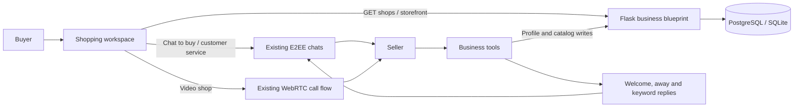
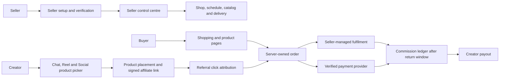
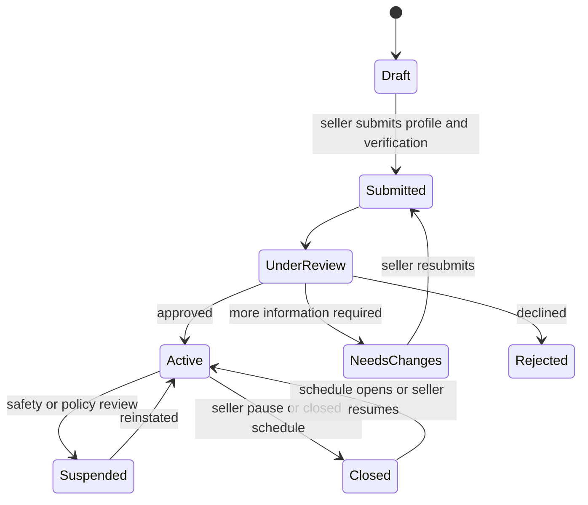
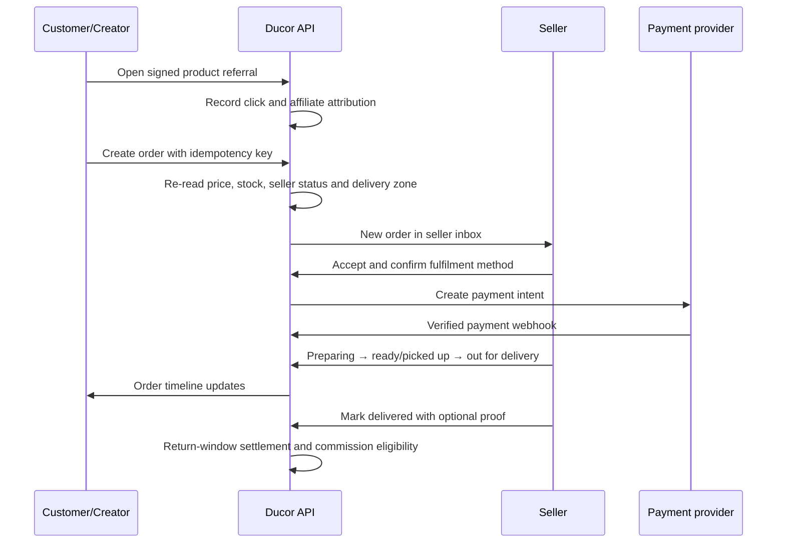

# Ducor Shopping Marketplace Architecture

## Product scope

Shopping is a first-class workspace beside Chats on desktop and a Shop tab in
the mobile chat navigation. It is removed from the message attachment menu.
The marketplace helps customers discover opt-in local shops, browse products
and projects, start a private seller conversation, and move into a video call
to inspect an item. Sellers manage their public storefront, catalog and support
automations through the existing Business tools.

Shopping now supports a reviewed seller account, saved weekly hours, seller
delivery and pickup choices, server-priced order requests, seller fulfillment
status, and tracked affiliate links that can be placed into Chat, Reels and
Social posts. The existing private chat and in-app voice/video contact remain
available for questions and item inspection.

This document describes the implemented seller and affiliate workflows plus
the target payment settlement architecture. Razorpay marketplace checkout and
seller payouts remain deliberately disabled until a compliant settlement
provider and full jurisdiction-specific verification are selected.

## Implementation state and launch boundary

- Seller applications capture legal owner name, seller type, address, PAN or
  GSTIN and (for registered businesses) registration number. Seller private
  fields and uploaded identity, address, tax and registration documents are
  encrypted with AES-GCM. Admins use authenticated, audited review and download
  endpoints. Public shop responses never include these fields or documents.
- Approved sellers configure a seven-day schedule, timezone, delivery/pickup
  choices, products, prices and product commission rates. Discovery lists only
  approved shops that the seller has enabled.
- Buyers can create server-priced order requests while platform checkout is
  disabled. The backend checks stock, seller, delivery choice and address.
  Buyer and seller coordinate payment directly; the seller must explicitly
  confirm receipt before fulfillment starts. The app does not claim to verify
  this off-platform payment.
- Affiliate links can be shared in Chat, Reels and Social posts. A server-priced
  order tied to a referral creates a pending payout commission only after a
  verified capture or the seller confirms direct payment. Refunds reverse the
  commission. Payout execution remains unavailable.
- Secure marketplace checkout is disabled by default with
  `MARKETPLACE_CHECKOUT_ENABLED=false`. It also requires Razorpay keys and a
  verified webhook. The current payment integration accepts funds into the
  configured platform Razorpay account; a marketplace settlement or connected
  seller payout integration is not included. Keep checkout disabled until the
  operator has a compliant seller settlement process and has enabled it.
- The app collects encrypted seller documents and tax identifiers for manual
  application review, but this is not a complete Amazon-grade or provider
  KYC/tax verification. It does not collect bank details or create payout
  accounts. Razorpay checkout stays disabled until seller settlement,
  reconciliation, refunds and compliance review are ready.

## Architecture overview

The frontend owns marketplace presentation and search state in
`components/ShopMarketplace.jsx`. The home composition owns entry points and
passes the existing chat and call actions. Flask routes authenticate the
viewer, enforce opt-in publication, and serialize only storefront-safe data.
The existing `BusinessProfile`, `CatalogProduct`, `BusinessAutomation`,
`BusinessProfileView`, chat, message and call models remain the source of truth.

## Roles and capabilities

| Capability | Customer | Seller |
| --- | --- | --- |
| Discover shops | Search published shops by name, category and location | Opt in to appear in Shopping |
| View products/projects | Browse available catalog items and prices | Add, update, remove items and set stock |
| Ask questions or buy | Start an encrypted chat with the seller | Handle customer chats and share payment details |
| Inspect by video | Start an in-app video call with the seller | Answer a customer call using existing call controls |
| Storefront | Open a public, app-hosted shop profile | Register website, business profile, address and hours |
| Customer service | Chat with seller | Use welcome, away and keyword auto-replies |

## Complete seller lifecycle

### Amazon-style seller setup

The setup is a private workflow in Business tools. The current implementation
collects seller identity and operating details for manual review; it does not
establish payout eligibility:

1. **Seller type and legal identity:** individual or registered business,
   legal name, owner/authorized representative, country/region, date of birth
   where required by the configured verification provider, and business
   registration/tax identifiers where applicable.
2. **Verified contact:** business email and support contact. Phone verification
   uses the app's existing OTP flow; the seller's personal phone remains
   private in shop listings and shop calls.
3. **Shop profile:** public shop name and unique handle, logo, cover image,
   category, description, website, public pickup/location choice, currency and
   customer-service preferences.
4. **Manual document review:** upload required identity, address, tax and (for
   registered businesses) registration documents. App-level AES-GCM encryption
   protects document bytes and private fields. Authenticated admin review and
   download actions are audited; seller approval requires every required
   document to be verified.
5. **Settlement setup (future):** connect a compliant provider only after
   seller payouts, reconciliation and region-specific verification are ready.
   The current app does not collect bank information or create payout accounts.
6. **Fulfilment setup:** choose self-delivery, pickup, carrier shipping, or a
   combination; configure delivery areas, fees, handling time and service
   windows.
7. **Publish:** seller previews the storefront and explicitly submits it for
   review. Only an approved, active seller can open the shop to discovery and
   accept marketplace orders.

Verification requirements vary by launch country and payment provider. Keep
the collected fields configurable by provider and region; legal/compliance
review is a launch prerequisite, not a hard-coded assumption in the UI.

### Shop opening and closing

`ShopOperatingHours` stores one row for each weekday with local open/close
times and the shop's IANA timezone. `ShopHoursException` stores holidays and
one-off closures. The seller portal also offers **Open now**, **Close now** and
**Pause shop until…** overrides. The server computes `isOpen` from approved
seller status, shop publication state, weekly hours, exceptions and override;
the client clock is never authoritative.

When closed, the shop stays browseable with a **Closed** badge and next opening
time. Checkout and call requests can be disabled according to seller settings;
product pages and chat remain available, with opening hours and away/AI support
shown. Closing the shop never silently cancels an accepted order.

## Seller control centre

The seller owns the shop operations in Business tools:

- **Profile and verification:** edit public profile, private legal details,
  verification status, document requests and appeal/submission progress.
- **Catalog:** create/edit/archive products, set price, sale price, stock,
  variants, media, pickup eligibility and affiliate commission.
- **Store status:** weekly opening schedule, timezone, holiday exceptions and
  manual temporary open/closed state.
- **Orders:** accept/reject requests, confirm stock, prepare, hand off, mark
  delivered, message the customer, and handle cancellation/return/refund cases.
- **Delivery:** manage delivery methods, service zones, fees, delivery windows,
  pickup instructions, and per-order delivery status/proof.
- **Marketing:** create and pause product affiliate campaigns, set commission
  terms, and view creator referrals and attributed results.
- **Support and insights:** existing business auto-replies/AI plus shop views,
  product clicks, orders, cancellations, delivery performance and commission
  ledger.

Seller-managed delivery does not imply that the app dispatches a courier. The
seller chooses and performs the delivery method, records status and provides
the customer with updates in the order timeline. Carrier integration can be
added behind the same fulfillment interface later.

## Creator and affiliate shopping inside Ducor

Creators can add app catalog items directly while composing a Reel, Social
post, or a product card in Chat. The picker searches only approved,
marketplace-active products and shows the seller, current price, stock and
campaign terms. It must not accept arbitrary external product URLs as affiliate
items.

### Product placements

- **Reels:** a product tray/card is attached to the Reel. Viewers can open the
  verified product page without leaving the app.
- **Social posts:** the composer attaches one or more catalog products. Product
  cards appear under the post and link to the in-app storefront.
- **Chats:** share a versioned encrypted product-card message with product ID,
  seller ID, referral token and display snapshot. Message content remains
  end-to-end encrypted; the server does not inspect chat text to attribute a
  sale.
- **External share:** optional signed deep link opens the same in-app product
  page after app install/login and carries the creator referral token.

Every placement shows the **current** server price and availability when
opened. If the attached snapshot price differs from the live price, show the
current price and a changed-price notice. If the product or shop is unavailable,
keep the content visible but disable purchase and show the current status.

The seller creates an `AffiliateCampaign` for a shop or selected products,
sets the commission basis points, start/end time and eligible placements, then
activates it. A creator selects an active product, accepts the terms and gets a
signed, opaque referral token. Direct seller posts are tracked as seller-owned
promotion and do not pay an affiliate commission.

### Attribution and creator earnings

1. A viewer taps an attached product card. The server validates the signed
   referral token and records an `AffiliateClick` against creator, campaign,
   product and content placement.
2. Checkout copies the eligible referral ID to the server-owned order; the
   client cannot choose the creator or commission rate.
3. Order lines snapshot seller, product name, SKU/variant, quantity, unit price,
   discount, tax/shipping allocation and commission terms at purchase time.
4. Commission begins as **pending**. It becomes payable only after payment is
   verified, delivery is confirmed and the configured return/cancellation
   period ends. Cancellation, refund or return reverses the pending ledger
   entry.
5. Creator earnings appear in an auditable ledger. Payouts use the configured
   provider, minimum threshold, settlement status and retry handling.

Use a configurable attribution window and a documented last-qualified-click
rule. Store click IDs and referral tokens rather than device fingerprints.
Display **Affiliate product — creator may earn commission** on Reel, Social,
Chat product cards and product pages whenever a qualifying referral is present.

## Data model for the complete system

Reuse and migrate current records rather than creating a second independent
catalog:

| Entity | Main fields and relationships |
| --- | --- |
| `SellerAccount` | `user_id`, seller type, legal-name reference, verification state, region, provider account token, masked payout details |
| `SellerVerification` | seller, provider case/reference, requested document type, private object key, review state, reviewer, timestamps; never public |
| `Shop` / current `BusinessProfile` | seller, handle, public profile, publish state, moderation state, timezone, manual-open override |
| `ShopOperatingHours` | shop, weekday, local opening/closing time, closed flag |
| `ShopHoursException` | shop, local date/time range, closed or special hours, reason |
| `Product` / current `CatalogProduct` | seller, SKU, name, description, media, price in minor currency units, sale price, inventory, fulfillment flags, publish state |
| `DeliveryProfile` | shop, self-delivery/pickup/carrier choices, handling window, return instructions |
| `DeliveryZone` | delivery profile, postal-code/radius region, fee, free-delivery threshold, estimated window |
| `MarketplaceOrder` | buyer, seller, idempotency key, address snapshot, totals, payment state, referral link, order state |
| `MarketplaceOrderLine` | order, product reference plus immutable name/SKU/variant/price/quantity/commission snapshots |
| `OrderEvent` | order, actor, previous/new state, note, proof reference and timestamp; append-only audit trail |
| `AffiliateCampaign` | seller, eligible products/placements, commission basis points, dates, status and terms version |
| `AffiliateLink` | creator, campaign, product, signed opaque token and snapshotted commission terms |
| `AffiliateClick` | affiliate link, content placement, coarse event time and order attribution reference |
| `SocialPostProduct` / `ReelProduct` | content, product, affiliate link, sort order and display snapshot |
| `CommissionLedger` | creator, order line, pending/payable/paid/reversed amount, currency and source event |
| `CreatorPayout` | creator, provider transfer reference, amount, status, retry/error code and timestamps |

An order belongs to one seller. A multi-seller cart is split into one seller
order per shop so each seller independently accepts and fulfils their part.
Store money as integer minor units and commission as integer basis points;
backfill the current floating-point catalog price while preserving the legacy
API response during migration.

For content, use separate `SocialPostProduct` and `ReelProduct` association
tables with foreign keys rather than one polymorphic table with an unchecked
content ID. Chat product cards remain encrypted messages and resolve product
details through the public product API when opened.

## Target API surface

All private seller/customer APIs require authentication; public shop/product
reads require a published, active listing.

| Method and path | Purpose |
| --- | --- |
| `POST /api/seller/onboarding` | Create/resume a draft seller application |
| `PUT /api/seller/onboarding/profile` | Save legal/store setup steps |
| `POST /api/seller/onboarding/documents` | Upload a private verification document |
| `POST /api/seller/onboarding/submit` | Validate and submit for review |
| `GET /api/seller/onboarding/status` | Read seller application and required actions |
| `PUT /api/seller/shop` | Manage public profile, publish intent and storefront settings |
| `PUT /api/seller/shop/hours` | Save weekly opening hours and timezone |
| `PUT /api/seller/shop/status` | Set temporary open/closed override and expiry |
| `PUT /api/seller/delivery` | Manage self-delivery, pickup and service zones |
| `POST /api/seller/products`, `PUT/DELETE /api/seller/products/<id>` | Manage products, price, stock and fulfillment settings |
| `GET /api/marketplace/products?q=&category=&location=` | Discover active products for Shopping and content pickers |
| `POST /api/marketplace/orders` | Create an idempotent seller order from server-validated products |
| `GET /api/seller/orders` | Seller order inbox with filters and pagination |
| `POST /api/seller/orders/<id>/transition` | Apply an allowed seller order/delivery transition |
| `GET /api/marketplace/orders/<id>` | Buyer order status and event timeline |
| `POST /api/affiliate/campaigns` | Seller creates product/shop commission terms |
| `GET /api/affiliate/products?q=` | Search products with active creator terms |
| `POST /api/affiliate/click/<signed_token>` | Record a qualified product/content referral click |
| `GET /api/creator/affiliate/earnings` | Read attributed sales and commission ledger |
| `GET /api/creator/affiliate/payouts` | Read payout history/status |

Social/Reel create and edit APIs accept product attachment IDs and affiliate
link IDs, validate ownership/eligibility server-side, and return product cards
with live status. Chat card payloads use a versioned encrypted message type.

## Purchase and fulfillment flow

Allowed order transitions are server-owned: `requested → accepted →
payment_pending → paid → preparing → ready_for_pickup/out_for_delivery →
delivered → completed`. Explicit branches cover `rejected`, `cancelled`,
`refund_pending`, `refunded`, `return_requested` and `disputed`. The server
rejects invalid transitions, stale product prices, insufficient stock and
delivery addresses outside the seller's zones. Payment is successful only
after a verified provider webhook; client UI or chat messages cannot mark it
paid.

## Security, privacy and abuse controls

- Seller KYC documents and legal fields are private, access-logged, encrypted
  at rest and never included in storefront/product/content serializers.
- Payout details are provider tokens plus masked values. Verification review
  uses role-checked admin endpoints and immutable review history.
- Only `active` sellers publish products, accept orders and launch campaigns.
  Pausing or suspending a seller immediately disables new checkout and links;
  already accepted orders remain visible for resolution.
- The seller is authoritative for price, inventory, opening hours, delivery
  zone and commission terms. Checkout snapshots these values and ignores
  client-provided totals.
- Phone numbers remain hidden in shop chats and are never used for WebRTC
  calls. Public contact information is opt-in and distinct from login identity.
- Affiliate disclosures are mandatory on all placements. Invalid, expired or
  self-referral tokens do not earn commission; suspicious click/order patterns
  are held for review rather than paid automatically.
- Order and commission state changes are idempotent and append to audit/event
  ledgers. Refunds and returns reverse commissions before payout; settled
  payouts use a compensating adjustment rather than editing historical rows.
- AI support remains separately opted in and disclosed. E2EE means the current
  client-assisted implementation only replies while a seller app is online;
  server-side offline AI would require a separate business-chat encryption and
  consent design.

## Delivery plan

1. **Seller foundation:** private seller application, verification statuses,
   storefront draft/active states, weekly hours/timezone and seller portal.
2. **Fulfillment:** delivery profiles/zones, server-owned orders, seller inbox,
   buyer order history, payment webhook and order event timeline.
3. **Native product sharing:** catalog picker and product cards in Chat, Reels
   and Social, with live price/stock and app deep links.
4. **Affiliate attribution:** seller campaigns, creator terms, signed links,
   click attribution, disclosures, commission ledger and creator dashboard.
5. **Settlement and operations:** provider payouts, returns/disputes, fraud
   review, moderation tools, refunds, delivery integrations and audited admin
   workflows.

Each slice is additive to current marketplace routes. Backfill current
`BusinessProfile`/`CatalogProduct` records as unverified seller drafts; do not
auto-publish or auto-approve them. Existing chat/call APIs and E2EE envelopes
remain compatible.

## Data model

### Existing records reused

- `BusinessProfile`: business name, category, description, address, support
  details, website, hours, and catalog visibility.
- `CatalogProduct`: product/project name, description, INR price, image and
  stock availability.
- `BusinessAutomation`: welcome and away messages, keyword rules and
  explicit `ai_enabled` customer-support opt-in.
- `BusinessProfileView`: storefront view analytics.
- `Chat`, `ChatParticipant`, `Message` and `CallRecord`: secure customer
  support, purchase discussion and call lifecycle. `Chat.is_shop_chat` marks a
  buyer/seller conversation so participant phone fields stay hidden there.

### Marketplace publication

`BusinessProfile.marketplace_enabled` is the seller's explicit opt-in. The
field defaults to false, so existing businesses do not become publicly
discoverable after deployment. `catalog_visible` remains a second visibility
switch. A shop appears in public search only when both switches are enabled.
The schema upgrade is additive and the runtime compatibility migration adds
the column to existing databases.

No customer email, personal phone or internal automation data is returned by
the public marketplace serializers. A seller's registered website and shop
address are public while the listing is on. Video calls route through in-app
chat identity rather than revealing phone numbers.

## API contracts

All endpoints require the existing bearer token.

| Method and path | Purpose | Access |
| --- | --- | --- |
| `GET /api/business/shops?q=&category=&location=` | Search published shops; returns compact shop cards with up to six in-stock items | Authenticated users; published records only |
| `GET /api/business/storefront/<business_user_id>` | Load a single published storefront and full catalog; records a profile view | Authenticated users; published records only |
| `POST /api/business/shop-chat` | Open or create a buyer/seller chat without requiring a contact entry | Authenticated buyer; published shop only; blocks enforced |
| `GET /api/business/me` | Load seller profile, catalog and automation | Owner |
| `PUT /api/business/profile` | Save profile, website, catalog visibility and marketplace opt-in | Owner |
| `POST /api/business/products` | Add a catalog listing | Owner |
| `PUT /api/business/products/<id>` | Edit listing or stock | Owner |
| `DELETE /api/business/products/<id>` | Remove listing | Owner |
| `PUT /api/business/automation` | Save customer-service automations | Owner |
| `POST /api/business/automation/claim` | Atomically claim one incoming message and optionally return a generated AI reply | Shop owner in that chat |
| `GET /api/business/analytics` | Read profile views, product and message counts | Owner |

The older contact-only `GET /api/business/<id>` remains for the existing chat
profile drawer. Marketplace discovery uses the separate storefront contract so
existing chat privacy rules do not change.

## Main user flows

### Seller setup and publication

1. Seller opens Shopping and chooses **List your shop**, or opens Settings →
   Business tools → Seller setup & hours.
2. Seller registers the business name, category, description, address, support
   details, website and opening hours.
3. Seller adds products/projects in Catalog / Products, with price, image,
   description and stock.
4. Seller turns on **List my shop in Shopping** and saves. This explicitly
   publishes the storefront. Turning it off hides the store from discovery and
   storefront routes without deleting its catalog or private business data.
5. Seller enables welcome, away or keyword replies. Seller may separately
   enable AI customer support. The AI switch is off by default and the UI
   explains that customer messages are sent to the configured AI provider.

### Customer discovery and purchase conversation

1. Customer opens Chats → Shopping and searches by shop name, category or
   location.
2. Customer opens a shop and reviews its website, address, hours and catalog.
3. **Request order** creates a server-priced request with seller-selected delivery.
   While checkout is disabled, buyer and seller agree payment in chat; the seller
   confirms receipt before fulfillment. **Chat to buy** opens or creates the
   existing direct chat with a prefilled product inquiry. The customer reviews and sends it. Product questions, order details, delivery arrangements and payment
   confirmation stay in that private conversation.
4. Customer or seller can use the existing UPI/payment composer within chat.
   Marketplace UI does not mark a payment as successful; server-verified
   payment state remains authoritative.

### Video inspection

1. Customer opens a published shop and chooses **Video shop**.
2. The app opens/creates a direct chat, requests camera and microphone access,
   and starts the existing WebRTC voice or video-call flow for that chat.
3. Seller answers through the existing incoming-call UI and shows the item live.
4. Call signaling uses app account/chat identifiers; the marketplace does not
   expose either user's phone number.

### AI customer support

1. Seller enables the regular business auto-reply switch and separately opts
   in to **AI customer support**. This opt-in is off by default.
2. The buyer sees an AI-processing notice on the storefront before opening the
   chat. Every generated response starts with an AI assistant disclosure.
3. The seller's logged-in app decrypts the incoming E2EE message and sends its
   text to the business AI endpoint only after the seller opted in. The backend
   uses the seller's profile and catalog as grounded facts, requests a concise
   reply, and does not save a separate copy of the customer text.
4. The seller's client encrypts the reply for the chat participants and sends
   it through the existing chat socket event. Keyword and welcome replies
   remain available as fallback if AI is unavailable.

Because chat content is end-to-end encrypted, this client-assisted AI reply
requires the seller's app to be online and signed in. It does not decrypt or
process buyer messages on the server while the seller is offline.

## Security and operational rules

- A listing is visible only when both `marketplace_enabled` and
  `catalog_visible` are true; unlisted and missing profiles return no shop.
- Owner-only catalog, profile and automation mutations use the authenticated
  user ID. Product update/delete queries include both product ID and owner ID.
- Only a published shop can start a marketplace chat without a contact entry;
  blocks are enforced. Shop chats hide participant phone fields regardless of
  the account's general phone visibility setting.
- Public storefront serializers use an allowlist and never return seller email,
  support phone, automation configuration, or non-public account fields.
- Customer conversations and calls use existing chat membership checks,
  encryption envelopes, call invitations and abuse controls.
- Business AI is separately opted in, disclosed to the customer, grounded in
  the seller's profile/catalog, and runs only while the seller client is online
  to preserve the existing E2EE boundary.
- Shop website links are restricted by the client to HTTP(S) before opening.
- Search results are capped at 60 shops and cards include at most six
  in-stock products; full product catalogs load only after a shop is opened.
- Analytics are informational counts. They are not proof of orders, revenue or
  successful payment.
